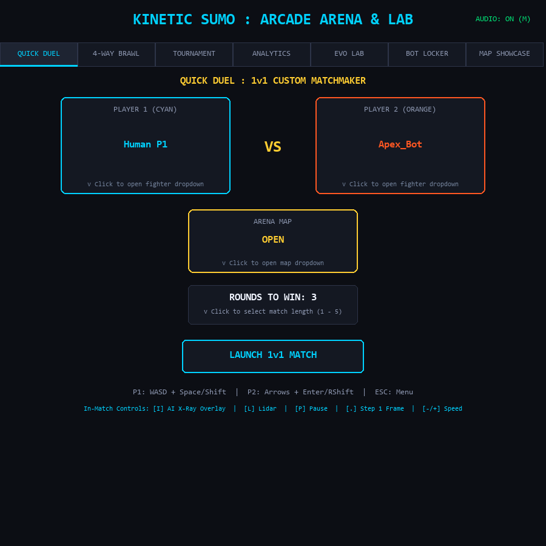
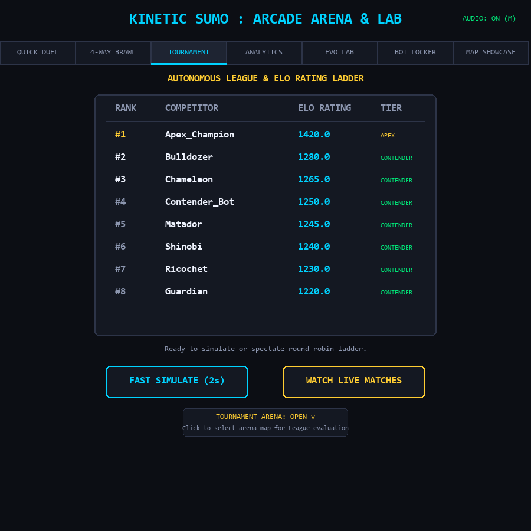
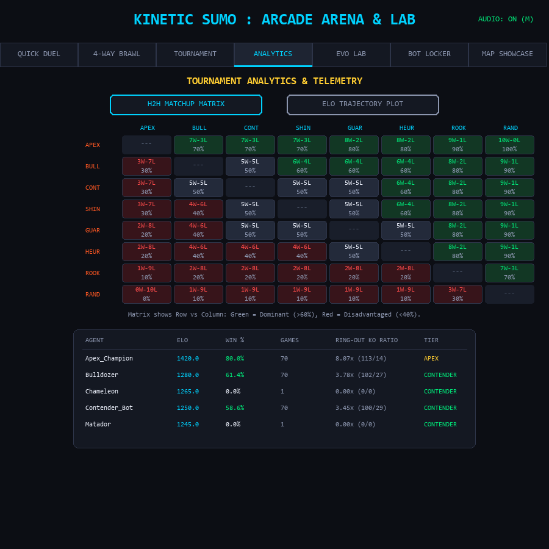
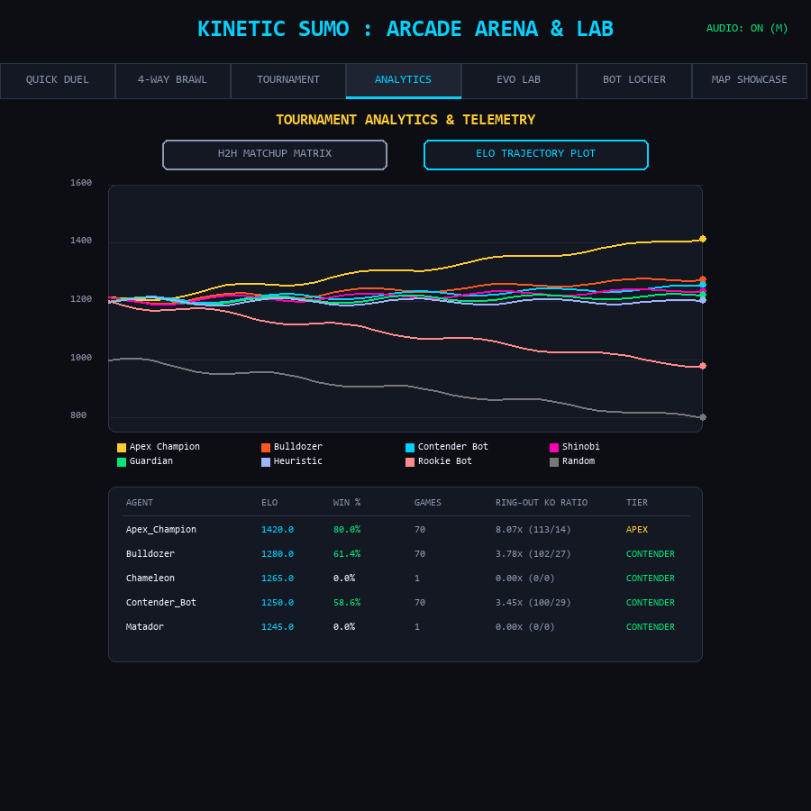
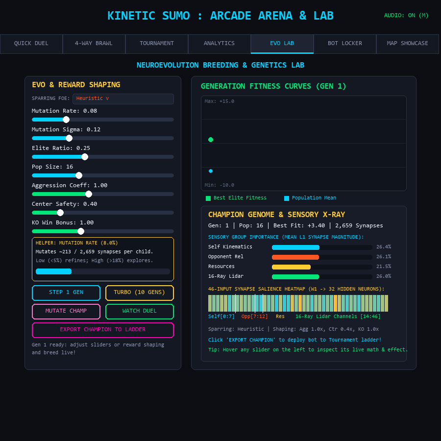
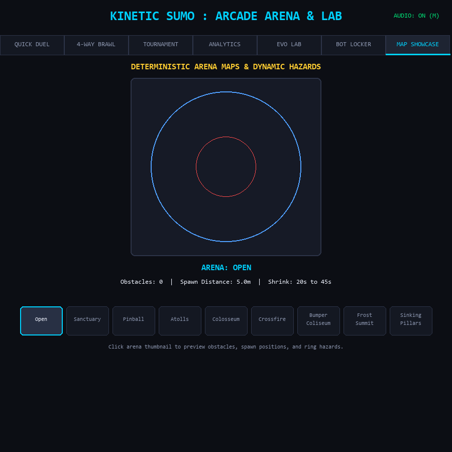

# Models Arena — Kinetic Sumo

[](https://www.python.org/)
[](https://pettingzoo.farama.org/)
[](https://pytorch.org/)
[](#6-quickstart--installation)
[](LICENSE)

An open-source, modular, CPU-optimized **Multi-Agent Reinforcement Learning (MARL)** framework, neuroevolution lab, and competitive 2D physics arena. Agents pilot high-inertia hovering discs armed with reinforced bumper shields, competing to knock opponents out of dynamically shrinking hazard rings.

Built for high throughput on standard CPU hardware with **pure NumPy vectorized physics achieving >100,000 steps/sec per core**, full `PettingZoo ParallelEnv` compliance, progressive ML fighter tiers, live in-app genetic breeding, and tournament analytics.

---

## Arcade Hub & Visual Gallery

| Quick Duel & Fighter Select | Tournament Elo Ladder |
| :---: | :---: |
|  |  |

| Head-to-Head Matchup Matrix | Multi-Line Elo Trajectory |
| :---: | :---: |
|  |  |

| Interactive Evolution Lab | Arena Map & Hazard Showcase |
| :---: | :---: |
|  |  |

---

## 1. Key Features

* **Pure NumPy Vectorized 2D Physics Engine**: Deterministic elastic disc collisions, angular momentum damping, directional $120^\circ$ front bumper shields, flank/rear impulse multipliers, and vectorized 16-ray Lidar raycasting.
* **Progressive ML Hierarchy & 7 Tactical Archetypes**:
  * **ML Progression**: Climb from `Rookie_Bot` ($\sim 960$ Elo) $\rightarrow$ `Contender_Bot` ($\sim 1250$ Elo) $\rightarrow$ `Apex_Champion` ($\sim 1495$ Elo), alongside `SelfPlay_PPO` and `Neuroevolution_GA`.
  * **Tactical Bots**: `Bulldozer` (hyper-aggressive rammer), `Shinobi` (evasive flanker), `Guardian` (center-ring anchor), `Matador` (edge-baiter & perpendicular juke-dash bullfighter), `Ricochet` (16-ray Lidar obstacle weaver & pinball bumper herder), `Chameleon` (dynamic 3-stance counter-fighter), and user-customizable `Tunable` bots with savable presets.
* **Behind-the-Scenes AI X-Ray & Genome Telemetry**:
  * **Live Match AI X-Ray Overlay (`I` key)**: Real-time HUD telemetry displaying each bot's active tactical state/intent, arena aim vectors, bidirectional `THR` / `STR` / `ABL` actuator gauges (with `-0.5` Anchor and `+0.5` Dash trigger ticks), and live PBRS vs. contact reward breakdown.
  * **Champion Genome Sensory & Synapse Heatmap (`EVO LAB`)**: Visualizes the evolved neural network's L1 sensory group importance (`Self Kinematics`, `Opponent Rel`, `Resources`, `16-Ray Lidar`) alongside a 46-channel input synapse salience heatmap (`W1 -> 32 Hidden`).
* **Interactive Evolution Lab (`EVO LAB`) & Pre-Training Parameter Helpers**:
  * **Live "Under the Hood" Inspector Cards**: Hovering or dragging any hyperparameter or tuning slider in `EVO LAB` or `BOT LOCKER` displays the exact mathematical formula, physical threshold (`m`, `m/s`, $K_p$, mutated synapse count out of `2,659`), and a visual preview bar.
  * **Pre-Training Reward Shaping Sliders**: Tune `Aggression Coeff`, `Center Safety`, and `KO Win Bonus` before breeding to steer evolution toward hyper-aggressive strikers or patient center-control sumo masters.
* **Direct Dropdown Selectors & Simulation Time Controls**:
  * **Interactive Dropdown Menus**: Pick fighters, human slots, custom presets, maps, sparring partners, and match lengths directly across `QUICK DUEL`, `4-WAY BRAWL`, `TOURNAMENT`, and `EVO LAB`.
  * **Live Simulation Time Controls**: Pause (`P`), step forward 1 exact physics frame (`.`), or scale simulation speed from `0.25x` slow-motion to `4.0x` fast-forward (`-` / `+`) during any match.
* **Deep Tournament Analytics (`ANALYTICS`)**:
  * **Head-to-Head Confusion Matrix**: Dynamic $N \times N$ heatmap displaying exact win-loss records and win percentages for every bot pairing.
  * **Elo Trajectory Timeline**: Multi-line rating progression chart across tournament matches, paired with real physical ring-out KO ratios.
* **9 Deterministic Hazard Arenas**:
  * Classic geometric arenas: `Open`, `Sanctuary`, `Pinball`, `Atolls`, `Colosseum`, `Crossfire`.
  * Dynamic hazard arenas: `Bumper_Coliseum` ($2.0\times$ active pinball rebound bumpers), `Frost_Summit` (low-friction ice drift), and `Sinking_Pillars` (stepped collapsing ring sectors).

---

## 2. System Architecture

```text
models-arena/
├── pyproject.toml
├── LICENSE
├── README.md
├── checkpoints/            # Pre-trained GA (.npy) & PPO (.pt) model weights
├── src/
│   ├── engine/             # Headless pure NumPy 2D physics & raycasting
│   │   ├── entities.py     # Disc kinematics, mass, moment of inertia, bumper arcs
│   │   ├── physics.py      # Elastic collisions, surface friction, bumpers, ring collapse
│   │   └── raycast.py      # Vectorized 16-ray Lidar intersection engine
│   ├── env/                # PettingZoo ParallelEnv & high-speed vector environments
│   │   ├── arena_env.py    # 1v1 PettingZoo ParallelEnv wrapper
│   │   ├── arena_4way_env.py # 4-Player Battle Royale Free-For-All environment
│   │   ├── vector_env.py   # Pure NumPy batch simulator (>100k steps/sec)
│   │   ├── rewards.py      # PBRS potential, kinetic exchange, anti-exploitation
│   │   └── maps.py         # Extended hazard map registry
│   ├── maps.py             # Core deterministic arena presets & obstacle definitions
│   ├── agents/             # AI policies & neural network architectures
│   │   ├── base.py         # Abstract BaseAgent interface
│   │   ├── progressive.py  # Tiered ML policies (Rookie, Contender, Apex)
│   │   ├── tactical.py     # Bulldozer, Shinobi, Guardian & Tunable archetypes
│   │   ├── heuristic.py    # Rule-based PD steering & intercept state machine
│   │   ├── ga_mlp.py       # Flat NumPy MLP (46 -> 32 -> 32 -> 3) for Neuroevolution
│   │   └── ppo_policy.py   # PyTorch Actor-Critic MLP policy (CleanRL style)
│   ├── training/           # Self-play & evolutionary training loops
│   │   ├── train_ga.py     # Multiprocessing genetic algorithm & mutation loop
│   │   ├── train_ppo.py    # Self-play PPO with GAE-lambda rollout buffer
│   │   └── league.py       # Prioritized Fictitious Self-Play (PFSP) matchmaking
│   ├── eval/               # Evaluation & Elo ratings
│   │   └── tournament.py   # Round-robin Elo ladder, H2H matrix & KO tracker
│   └── ui/                 # Arcade Hub GUI, rendering & procedural audio
│       ├── hub.py          # 7-Tab Interactive Arcade Hub (Duel, 4-Way, Analytics, Evo Lab)
│       ├── renderer.py     # Pygame-CE arena renderer (sparks, trails, lidar overlay)
│       ├── audio.py        # Real-time procedural sound synthesizer
│       └── play.py         # CLI & GUI entry point launcher
└── tests/                  # Pytest verification suite (80 unit & integration tests)
```

---

## 3. Gameplay & Combat Mechanics

### Continuous Action Space

$$
a = [\text{thrust}, \text{steer}, \text{ability}] \in [-1.0, 1.0]^3
$$

| Action Channel | Range | Physical Effect |
| :--- | :---: | :--- |
| **`thrust`** | `[-1.0, 1.0]` | Forward drive throttle (`[0, 1]` $\times 120\text{ N}$) or reverse braking (`[-1, 0]` $\times 60\text{ N}$). |
| **`steer`** | `[-1.0, 1.0]` | Rotational torque mapped to angular acceleration. |
| **`ability` > 0.5** | `(0.5, 1.0]` | **Dash Burst**: $2\times$ forward velocity surge, steering locked for $0.25\text{ s}$, costs $40\%$ energy. |
| **`ability` < -0.5** | `[-1.0, -0.5)` | **Anchor Brace**: $4\times$ ground traction, absorbs incoming impacts, zero forward drive. |

### Combat Rules
* **Front $120^\circ$ Reinforced Bumper**: Standard elastic collision recoil ($e = 0.8$).
* **Flank / Rear Hit**: Striking an opponent outside their front $120^\circ$ bumper arc delivers **$2.5\times$ knockback impulse** to the target and **cancels attacker recoil**.
* **Non-Linear Rotational Damping**: Rotational drag $\tau = -\mu \omega \lvert\omega\rvert$ prevents infinite spinning exploits.
* **Dynamic Ring Shrink**: Outer boundary shrinks from $10.0\text{ m}$ to $4.0\text{ m}$ between $t = 20\text{ s}$ and $t = 45\text{ s}$ (or steps down in discrete sectors on `Sinking_Pillars`). Crossing the boundary results in an instant ring-out KO.

---

## 4. Sensory Pipeline — Observation Space `(46,)`

Every agent receives a normalized, Markovian `float32` vector of shape `(46,)`:

| Slice | Dim | Category | Normalized Components |
| :--- | :---: | :--- | :--- |
| `obs[0:7]` | `7` | **Self Kinematics** | $x/R_0$, $y/R_0$, $v_x/V$, $v_y/V$, $\cos\theta$, $\sin\theta$, $\omega/\omega_{\max}$ |
| `obs[7:12]` | `5` | **Opponent Relative** | $\Delta x/(2R_0)$, $\Delta y/(2R_0)$, $\Delta v_x/(2V)$, $\Delta v_y/(2V)$, $\Delta\theta/\pi$ |
| `obs[12:14]` | `2` | **Resources** | $\text{energy}/E_{\max}$, $\text{cooldown}/CD_{\max}$ |
| `obs[14:46]` | `32` | **16-Ray Lidar Array** | 16 radial rays reporting distance $d_i \in [0, 1]$ and surface type $t_i \in \{-1.0, 0.0, 0.5, 1.0\}$ |

**Lidar Surface Encoding** $t_i$:
* `-1.0`: Void edge (ring-out boundary)
* `0.0`: Clear space (no hit within max ray range)
* `0.5`: Arena obstacle / pinball bumper pillar
* `1.0`: Opponent disc

---

## 5. Reward Architecture & Anti-Exploitation

$$
R_t = R_{\text{terminal}} + \bigl(\gamma \Phi(s') - \Phi(s)\bigr) + R_{\text{contact}} - R_{\text{penalties}}
$$

| Component | Symbol | Formulation & Purpose |
| :--- | :---: | :--- |
| **Terminal** | $R_{\text{terminal}}$ | Win $= +1.0$, Loss $= -1.0$, Timeout Draw $= -1.0$ (eliminates passive stalling). |
| **PBRS Potential** | $\Phi(s)$ | $0.4\,\Phi_{\text{center}}$ $+$ $0.6\,\Phi_{\text{closing}}$ (rewards center control & closing speed). |
| **Kinetic Contact** | $R_{\text{contact}}$ | $+0.4\,(J_{\text{opp}} / V)$ $-$ $0.1\,(J_{\text{self}} / V)$ $+$ $0.3\,I_{\text{flank}}$ |
| **Spin Suppression** | $P_{\text{spin}}$ | $-0.05 \cdot \max(0, \lvert\omega\rvert - 1.0)^2$ |
| **Actuator Jitter** | $P_{\text{jitter}}$ | $-0.01 \cdot \lVert \Delta a \rVert^2$ where $\Delta a =$ $a_t$ $-$ $a_{\text{prev}}$ |
| **Time Penalty** | $P_{\text{time}}$ | $-0.002$ per simulation step |

---

## 6. Quickstart & Installation

```bash
# Clone the repository and install in editable mode
git clone https://github.com/gebersohl-ds/models-arena.git
cd models-arena
pip install -e .
```

### Interactive Arcade Hub & Gameplay

```bash
# 1. Launch the 7-Tab Interactive Arcade Hub GUI (Default)
python -m src.ui.play

# 2. Direct 1v1 Duel (Human vs Apex Champion on Bumper Coliseum)
python -m src.ui.play --agent0 human --agent1 apex --map Bumper_Coliseum

# 3. 4-Way Battle Royale FFA (Last Disc Standing)
python -m src.ui.play --4way --map Crossfire

# 4. Watch Live Visual AI Tournament
python -m src.ui.play --tournament --matches-per-pair 2 --map Open
```

### Benchmarking, Training & Testing

```bash
# Run headless round-robin Elo tournament ladder (K=32)
python -m src.eval.tournament --matches-per-pair 10 --map Open

# Train Neuroevolution GA (Genetic Algorithm)
python -m src.training.train_ga --pop-size 64 --generations 20 --map Open

# Train Self-Play PPO (Prioritized Fictitious Self-Play)
python -m src.training.train_ppo --timesteps 50000 --num-envs 16 --map Open

# Run full automated test suite (80 tests)
python -m pytest -v
```

### Controls

| Input | Player 1 (Cyan) | Player 2 (Orange) |
| :--- | :---: | :---: |
| **Drive / Brake** | `W` / `S` | `Up` / `Down` |
| **Steer Left / Right** | `A` / `D` | `Left` / `Right` |
| **Dash Burst** | `Space` | `Return` / `RCtrl` |
| **Anchor Brace** | `LShift` | `RShift` |

* **Global & Match Hotkeys**: `TAB` (Cycle Hub Tabs), `I` (Toggle AI X-Ray Telemetry Overlay), `L` (Toggle Lidar Rays), `P` (Pause/Resume Match), `.` / `N` (Step 1 Physics Frame), `-` / `+` (Adjust Sim Speed `0.25x`–`4.0x`), `M` (Mute/Unmute Audio), `R` (Reset Match), `ESC` (Return to Hub / Exit).

---

## License

This project is licensed under the [MIT License](LICENSE).
